<!-- _class: lead -->
<!-- _paginate: false -->

# フロントエンド中心キャリアでの<br>技術スタック変遷

## マネージドサービスと共に<br>(できるだけ手抜きで)<br>歩んできた軌跡とこれから

YasunoriMATSUOKA

---

## 自己紹介

- **YasunoriMATSUOKA**
- 新潟拠点・フルスタックエンジニア
- キャリアの軸はフロントエンド
- バックエンド・インフラは **コスパよくマネージドなサービスを使い倒してきた** スタンス

---

## 今日のアジェンダ

1. キャリアで触れてきた技術スタックの変遷（時系列）
2. 各フェーズでの学びと、つらみ
3. フロントエンドFW / ホスティング / インフラ / バックエンドの変遷整理
4. 最近気になっている組み合わせ
5. まとめ — 最近思うこと

> ※ 個人の体験・主観です。各技術への dis ではなく、当時の自分から見えた風景としてお聞きください 🙏

---

<!-- _class: lead -->

# Part 1
## キャリアで触れてきたスタックの変遷

---

## ① 個人開発時代 (1/3) — スタック概観

<div class="logos">
  
  
  
  
  
</div>

<div class="stack">
<strong>Stack:</strong> JavaScript / Vue.js / Monaca(Cordova) / Onsen UI<br>
<strong>Backend:</strong> 全部ブロックチェーンに任せる
</div>

- ブロックチェーン関連の **ウォレットアプリ** を個人で作っていた
- Monaca + Cordova でクロスプラットフォーム化
- リリースには至らなかったが、ここで出会ったブロックチェーン系スタートアップに転職
- **フロントエンドエンジニアとしてのキャリアがここからスタート** 🚀

---

## ① 個人開発時代 (2/3) — 構成

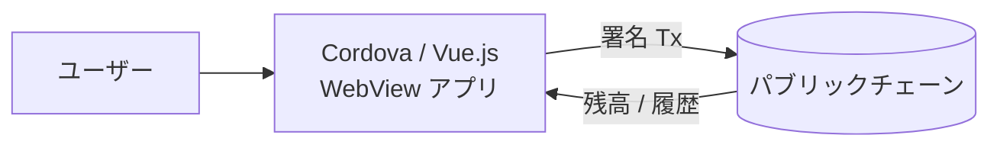

<div class="note">バックエンドサーバーは持たず、署名済みトランザクションをパブリックチェーンに直接投げる構成。</div>

---

## ① 個人開発時代 (3/3) — コード（送金 UI の素朴版）

```ts
// MetaMask / ウォレットプロバイダ経由の送金。Vue 側から呼び出してビューに bind
async function send(to: string, amountEth: string) {
  const provider = new ethers.providers.Web3Provider(window.ethereum)
  await provider.send('eth_requestAccounts', [])
  const signer = provider.getSigner()
  const tx = await signer.sendTransaction({
    to,
    value: ethers.utils.parseEther(amountEth),
  })
  return tx.wait()
}
```

<div class="learn">
個人開発が次のキャリアの扉を開く。技術選定よりも「動くものを出して人に見せる」ことと「リアルな場でそれを発信する」ことが大事だった。
</div>

---

## ② SES 1社目 — Nuxt.js (1/3)

<div class="logos">
  
  
  
  
  
</div>

<div class="stack">
<strong>Stack:</strong> JavaScript / Nuxt.js (Vue.js) / Bulma / VeeValidate
</div>

- 多言語対応が必要な **大規模 SPA**
- **1フォームに要素100個超**、i18n キー無数、バリデーションロジックがカオス
- TypeScript ではなく **JS なので型支援ゼロ**
- あらゆるエッジケースで表示・ロジックのバグが出まくり、矛盾点と戦う日々

---

## ② SES 1社目 (2/3) — 構成

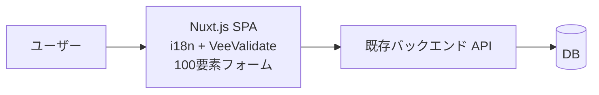

<div class="note">バリデーション・条件分岐・i18n キーがすべてフロント側に集中、しかも JS で型ナシ。</div>

---

## ② SES 1社目 (3/3) — VeeValidate 当時のフィーリング

<!-- _class: compact-code -->

```js
// VeeValidate v2 当時。フィールドが 100 個あると、こういう shape が
// 100 倍に膨れ上がる。型がないので「どこに何が入るか」をひたすら覚える
export default {
  data: () => ({
    form: { name: '', email: '', addr: '', /* ...×100 */ },
  }),
  computed: {
    rules() {
      return {
        name:  'required|min:1|max:100',
        email: 'required|email',
        addr:  this.form.country === 'JP' ? 'required|jp_postal' : 'required',
        /* ...×100 */
      }
    },
  },
}
```

<div class="pain">
今 TS に慣れた状態だと、たぶんもう同じ仕事はできない…<br>
でも、ここで「型がないこと」のしんどさを身体で覚えた。
</div>

---

## ③ SES 2社目 — jQuery × Spring Boot (1/3)

<div class="logos">
  
  
  
  
  
</div>

<div class="stack">
<strong>Front:</strong> JavaScript / jQuery<br>
<strong>Back:</strong> Kotlin / Spring Boot / MySQL
</div>

- カオスな jQuery 実装に苦しみながらフロントエンド開発
- 一部はバックエンド（Kotlin / Spring Boot）のバグ修正にも踏み込む
- **DOM を直接いじるアーキテクチャの限界** を実感
- 一方で、**Spring Boot の堅牢さ** と Kotlin の書き味は印象的だった

---

## ③ SES 2社目 (2/3) — 構成

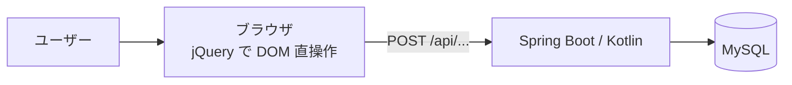

---

## ③ SES 2社目 (3/3) — フロント側 vs バック側

```js
// jQuery: DOM を直接書き換える。複雑な分岐が増えると依存が見えなくなる
$('#btn').on('click', function () {
  $('#total').text('計算中...')
  $.post('/api/calc', { x: $('#x').val(), y: $('#y').val() }, function (res) {
    $('#total').text(res.value)
    if (res.warning) $('#warn').show().text(res.warning)
  })
})
```

```kotlin
// Kotlin + Spring Boot: 入力 DTO 〜 Service までが型で繋がる気持ちよさ
@RestController
class CalcController(private val service: CalcService) {
  @PostMapping("/api/calc")
  fun calc(@RequestBody req: CalcReq): CalcRes = service.run(req)
}
```

<div class="learn">モダンFW のありがたさは、レガシーを触ったときに初めて分かる。</div>

---

## ④ SES 3社目 — E2E × 画像処理 (1/3)

<div class="logos">
  
  
  
  
  
</div>

<div class="stack">
<strong>Stack:</strong> Python (OpenCV / scikit-learn) / Selenium / Appium
</div>

- Web & アプリ向け E2E テスト基盤の **PoC 開発**
- **高精度スクリーンショット** + 画像処理で **自動デグレード検出**
- Selenium / Appium のクセ、待機制御、Flaky テストとの戦い

---

## ④ SES 3社目 (2/3) — パイプライン

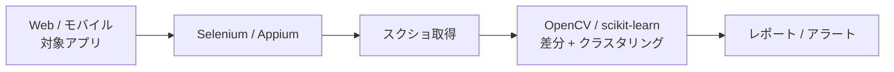

---

## ④ SES 3社目 (3/3) — 差分検出（核となる発想）

```python
# 同じ画面で 2 バージョンのスクショを比較し、変化量で回帰検知
import cv2
import numpy as np

def diff_ratio(a_path: str, b_path: str) -> float:
    a = cv2.imread(a_path, cv2.IMREAD_GRAYSCALE)
    b = cv2.imread(b_path, cv2.IMREAD_GRAYSCALE)
    if a.shape != b.shape:
        b = cv2.resize(b, (a.shape[1], a.shape[0]))
    diff = cv2.absdiff(a, b)
    return float(np.count_nonzero(diff > 10)) / diff.size
```

<div class="pain">
E2Eテストの「ちゃんと動かし続ける」ことの難しさを痛感。<br>
ビジュアルリグレッションは銀の弾丸じゃない。
</div>

---

## ⑤ ブロックチェーンSPの自社開発 (1/3) — スタック

<div class="logos">
  
  
  
  
  
  
  
  
  
  
  
  
  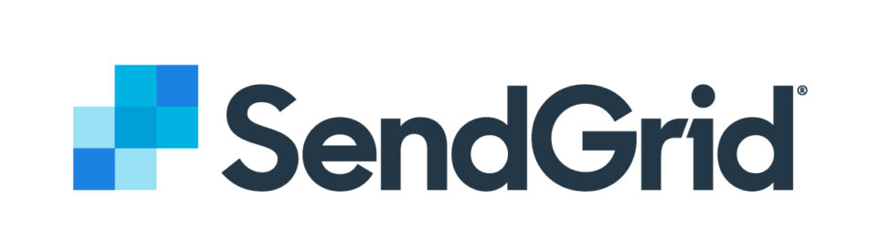
  
  
</div>

<div class="stack">
<strong>Front:</strong> TypeScript / Angular / RxJS / Tailwind CSS<br>
<strong>BaaS:</strong> Firebase (Hosting / Functions / Firestore / Storage) / Algolia<br>
<strong>GCP:</strong> BigQuery / Secret Manager<br>
<strong>SaaS:</strong> Stripe / SendGrid / GitHub Actions<br>
<strong>Chain:</strong> Go / Cosmos SDK / Docker / VPS (Vultr)
</div>

- **コスパよくスケールする SaaS** をゼロから立ち上げ
- 検索 / 決済 / メールを **マネージドで組む** ノウハウ蓄積
- **今の自分の礎**になった現場

---

## ⑤ ブロックチェーンSPの自社開発 (2/3) — 構成

<!-- _class: diagram-large -->

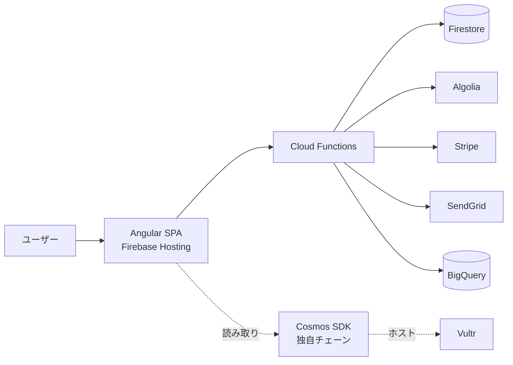

---

## ⑤ ブロックチェーンSPの自社開発 (3/3) — Firestoreトリガーの勘所

```ts
// onCreate トリガーで集計を更新。重複起動でカウントが二重に進むのを防ぐ
import { onDocumentCreated } from 'firebase-functions/v2/firestore'
export const onPostCreate = onDocumentCreated('posts/{id}', async (event) => {
  const id = event.params.id
  await db.runTransaction(async (tx) => {
    const seenRef = db.doc(`stats/global/seen/${id}`)
    const seen = await tx.get(seenRef)
    if (seen.exists) return                                       // 冪等ガード
    tx.set(seenRef, { at: FieldValue.serverTimestamp() })
    tx.update(db.doc('stats/global'), { count: FieldValue.increment(1) })
  })
})
```

<div class="pain">
トリガー連鎖と冪等性の規律が無いと、簡単にデータが壊れる。<br>
シミュレータ重い・セキュリティルール厳しい・クエリも貧弱…
</div>

---

## ⑥ NPO法人の自社開発 — 初React (1/3)

<div class="logos">
  
  
  
</div>

<div class="stack">
<strong>Stack:</strong> TypeScript / React / Firebase 系
</div>

- それまで Vue.js / Angular を中心に書いてきた身として
- **React 特有のクセ** に翻弄されまくる
  - 関数コンポーネントの再レンダリング、クロージャ、`useEffect` 依存配列…
  - **「Reactの気持ち」を考えないと書けない**
- Vue / Angular の宣言的さに慣れた身には、衝撃の連続

---

## ⑥ NPO法人 (2/3) — 構成

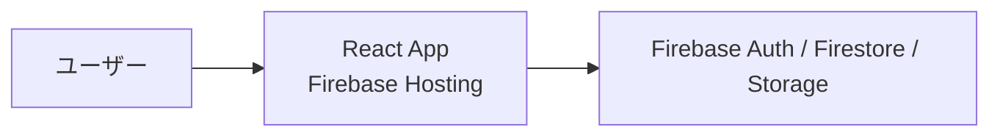

---

## ⑥ NPO法人 (3/3) — useEffect の罠

```tsx
function Counter({ id }: { id: string }) {
  const [count, setCount] = useState(0)

  // ❌ id が変わっても fetch が再実行されない
  useEffect(() => {
    void fetchCount(id).then(setCount)
  }, [])

  // ✅ 依存配列に id を入れる。これを忘れ続けるとデータが古いまま固まる
  // useEffect(() => { void fetchCount(id).then(setCount) }, [id])

  return <div>{count}</div>
}
```

<div class="pain">
React は「文法」より「メンタルモデル」のFW。<br>
JS / TS の知識だけでは戦えない。
</div>

---

## ⑦ Svelte をちょっと触る (1/2)

<div class="logos">
  
</div>

<div class="stack">
<strong>Stack:</strong> Svelte（ブロックチェーン関連サービス）
</div>

- ブロックチェーン関連の案件で少しだけ Svelte に触れた
- 印象は **Vue.js に近い**、リアクティビティが言語レベルに溶けていて書きやすい
- ボイラープレートが少なく、楽しい書き味

---

## ⑦ Svelte (2/2) — リアクティブの感覚

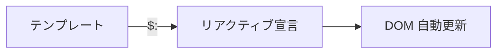

```svelte
<script>
  let count = 0
  // 自動で再評価される。React の useMemo 相当が文法に溶けている
  $: doubled = count * 2
</script>

<button on:click={() => count++}>+1</button>
<p>{count} × 2 = {doubled}</p>
```

<div class="learn">
コンポーネントFWの「書き味」には、ちゃんと差がある。Svelte は静かに良い。
</div>

---

## ⑧ フリーランス — Next.js × Vercel × Supabase (1/3)

<div class="logos">
  
  
  
  
  
  
</div>

<div class="stack">
<strong>Stack:</strong> TypeScript / Next.js / Vercel / Supabase<br>
<strong>必要に応じて:</strong> Terraform / GCP (Cloud Run など)
</div>

- Next.js / Vercel / Supabase の組み合わせに本格的に入る
- Supabase は **PostgreSQL** ベース → Firestore からの移行で…
  - SQL クエリの柔軟さに感動
  - DB Schema マイグレーションの堅牢さに感動
- **このあたりから AI に書かせる比重が増えてくる**（Cursor 等）

---

## ⑧ Next + Vercel + Supabase (2/3) — 構成

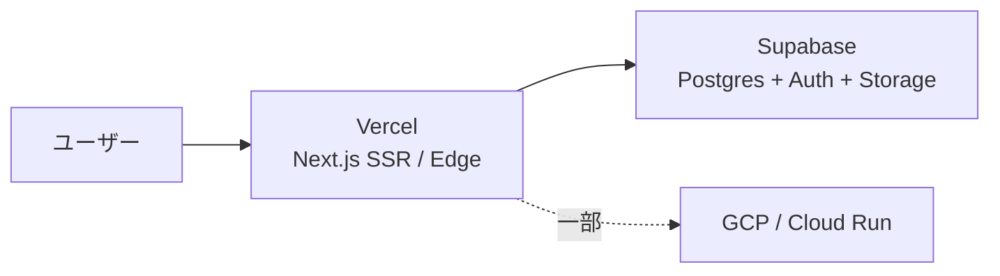

---

## ⑧ Next + Vercel + Supabase (3/3) — Supabase + RLS で読む

```ts
// auth.uid() を前提にした RLS が設定済みなら、クライアントから直接 select で OK
import { createClient } from '@supabase/supabase-js'
const supabase = createClient(url, anonKey)

const { data, error } = await supabase
  .from('posts')
  .select('id, title, author:profiles(name)')
  .eq('is_published', true)
  .order('created_at', { ascending: false })
  .limit(20)
```

<div class="learn">RDB の「当たり前」が、こんなにありがたいとは。</div>

---

## ⑨ 友人 SaaS — Vercel × Supabase (1/3)

<div class="logos">
  
  
  
  
  
</div>

<div class="stack">
<strong>Stack:</strong> TypeScript / Next.js / Vercel / Supabase<br>
<strong>AI:</strong> Cursor → Cline → Claude Code / Codex / Gemini
</div>

管理が楽な恩恵は大きい、でも…

<div class="pain">
<ul>
  <li><strong>Vercel の固定コストの重さ</strong>がじわじわ効いてくる</li>
  <li>Supabase 認証が DB Schema に与える<strong>暗黙の影響</strong>が大きく、ORM 連携でつらみ</li>
  <li><strong>Row Level Security</strong> の運用が想像以上にしんどい</li>
</ul>
</div>

---

## ⑨ 友人 SaaS (2/3) — 構成

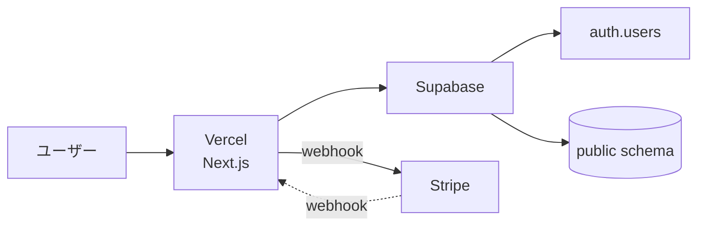

---

## ⑨ 友人 SaaS (3/3) — RLS ポリシーの書き味

```sql
-- profiles テーブル: 自分の行だけ select / update できる
create policy "own row select"
  on public.profiles for select
  using (id = auth.uid());

create policy "own row update"
  on public.profiles for update
  using (id = auth.uid())
  with check (id = auth.uid());

-- これを join 先 / 集計 / 隣接テーブルに全部書き続ける運用がしんどい
```

<div class="learn">「楽」と「コントロールできる」は別物。マネージドの粒度はちゃんと選ぶ必要がある。</div>

---

## ⑩ 友人 SaaS — Cloudflare Workers × Supabase (1/3)

<div class="logos">
  
  
  
  
</div>

<div class="stack">
<strong>Stack:</strong> TypeScript / Next.js / Cloudflare Workers / Supabase
</div>

- Cloudflare Workers の **コスパに驚愕** ⚡
- 一方で、Supabase の **コスト感の重さ** が相対的に目立つように
- 「フロント＋エッジ＋DB」のバランスを再考するきっかけに

---

## ⑩ CF Workers × Supabase (2/3) — 構成

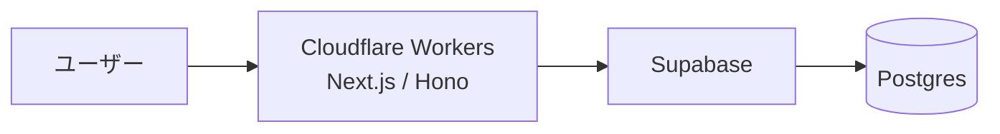

---

## ⑩ CF Workers × Supabase (3/3) — Hono on Workers

```ts
import { Hono } from 'hono'
import { createClient } from '@supabase/supabase-js'

type Env = { Bindings: { SUPABASE_URL: string; SUPABASE_ANON: string } }
const app = new Hono<Env>()

app.get('/posts', async (c) => {
  const supabase = createClient(c.env.SUPABASE_URL, c.env.SUPABASE_ANON)
  const { data } = await supabase.from('posts').select('*').limit(20)
  return c.json(data)
})

export default app
```

<div class="learn">Cloudflare のエッジファーストは、思っていた以上に強い。</div>

---

## ⑪ 友人 SaaS の移行 — PHP / Laravel / React (1/3)

<div class="logos">
  
  
  
  
</div>

<div class="stack">
<strong>Stack:</strong> PHP / Laravel / React (+ Inertia)
</div>

- 友人の SaaS の移行作業を手伝う
- **Laravel の成熟したバックエンドフレームワーク**としての便利さに感動
  - 認証・ORM・マイグレーション・キュー・ジョブ…全部揃ってる
  - 規約による設計の収束力

---

## ⑪ Laravel × React (2/3) — 構成

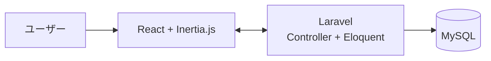

---

## ⑪ Laravel × React (3/3) — Controller + Inertia

```php
// Inertia::render で props を返すだけで、React 側に型付きでデータが届く
class PostController extends Controller {
  public function index() {
    return Inertia::render('Posts/Index', [
      'posts' => Post::query()
        ->where('is_published', true)
        ->latest()
        ->take(20)
        ->get(),
    ]);
  }
}
```

<div class="learn">TS エコシステムにはまだ無い、Laravel / Rails 級の<strong>統合された成熟</strong>がある。</div>

---

## ⑫ レガシー RN を Expo 化 / モダナイズ (1/3)

<div class="logos">
  
  
</div>

<div class="stack">
<strong>Stack:</strong> React Native / Expo / EAS
</div>

- 久々のアプリ開発、特に **iOS の本格デバッグはほぼ初体験**
- EAS Build / Update の世界観は思ったより快適
- コーディング自体は楽しかった

---

## ⑫ RN × Expo (2/3) — 構成

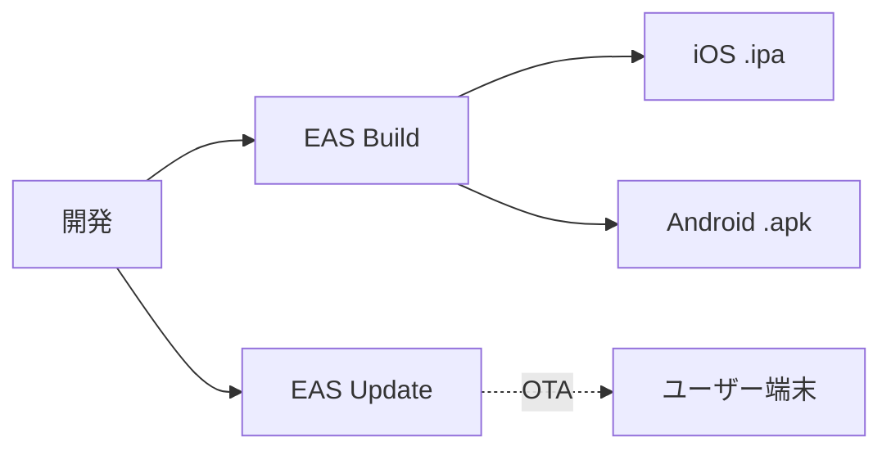

---

## ⑫ RN × Expo (3/3) — チャネル設定

```json
// eas.json: channel と環境を結びつけて OTA 配信を制御
{
  "build": {
    "production": { "channel": "production" },
    "staging":    { "channel": "staging" },
    "preview":    { "distribution": "internal", "channel": "preview" }
  },
  "submit":   { "production": { "ios": { "appleId": "..." } } }
}
```

<div class="pain">
…が、開発チームの<strong>外側の事情</strong>に振り回される時間が長く、<br>
技術以外のところで疲弊した案件でもあった。
</div>

---

## ⑬ 今ココ — Cloudflare ネイティブ (1/3)

<div class="logos">
  
  
  
  
  
  
  
  <span class="label">D1</span>
  <span class="label">R2</span>
  
</div>

<div class="stack">
<strong>Front:</strong> Next.js / Hono on Cloudflare Workers<br>
<strong>Storage:</strong> R2<br>
<strong>DB:</strong> D1（容量が一定）/ Turso（そうでない場合）<br>
<strong>Auth:</strong> Better Auth<br>
<strong>Mail:</strong> Cloudflare 完結 / 無理なら Resend<br>
<strong>Payment:</strong> Stripe
</div>

- **シンプルに Cloudflare に乗せる構成**を基本線に
- 「システムコストを極限まで削る」前提のアーキテクチャ選定

---

## ⑬ 今ココ (2/3) — 構成

<!-- _class: diagram-large -->

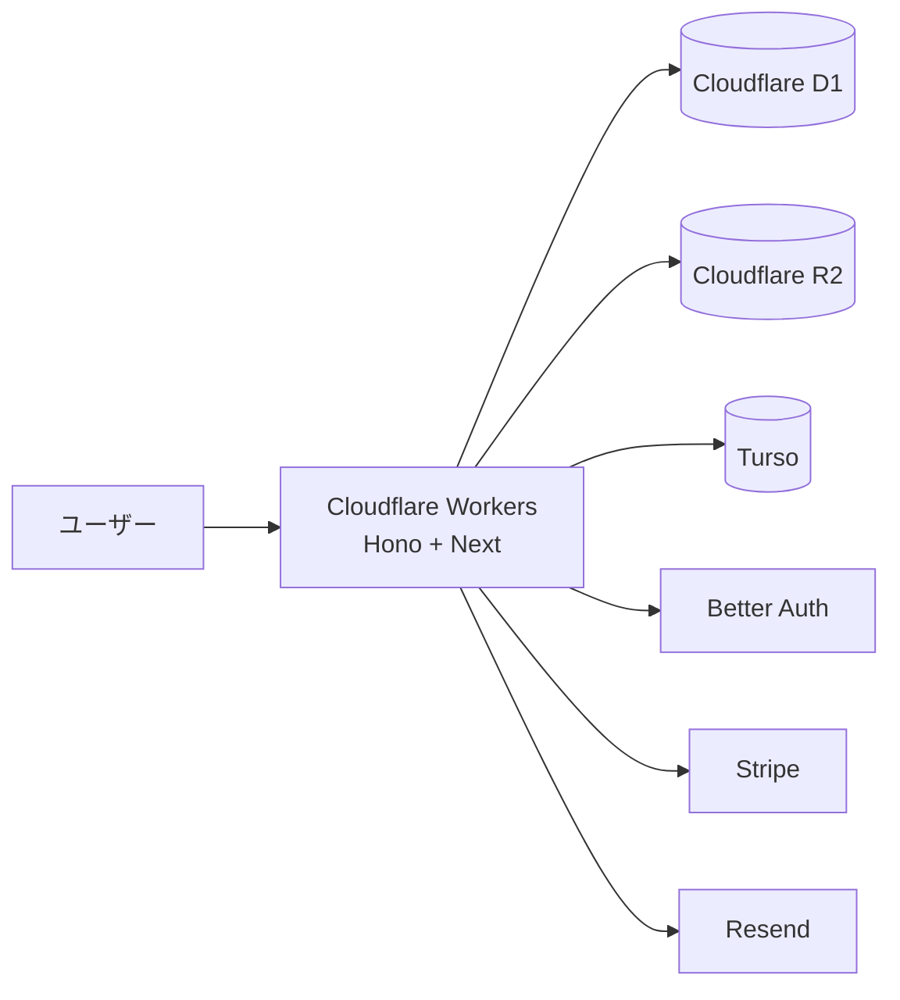

---

## ⑬ 今ココ (3/3) — Hono + D1 + Better Auth

```ts
import { Hono } from 'hono'
import { betterAuth } from 'better-auth'

type Env = { Bindings: { DB: D1Database; AUTH_SECRET: string } }
const app = new Hono<Env>()

const auth = betterAuth({ /* D1 アダプタ + 自前のセッション戦略 */ })
app.on(['GET', 'POST'], '/api/auth/*', (c) => auth.handler(c.req.raw))

app.get('/api/posts', async (c) => {
  const { results } = await c.env.DB
    .prepare('select id, title from posts where published = 1 order by id desc limit 20')
    .all()
  return c.json(results)
})

export default app
```

<div class="note">認証は Better Auth、データは D1 / Turso、配信はエッジ。コスト最適と主導権を両立する構成。</div>

---

<!-- _class: lead -->

# Part 2
## 大事にしてきたこと

---

## CI/CD パイプライン全体像

<!-- _class: diagram-medium -->

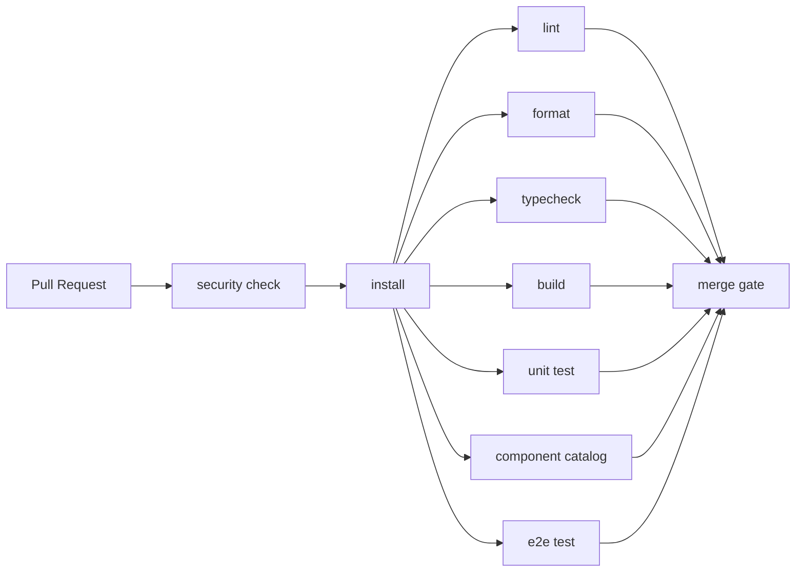

<div class="note">直列: <strong>security check → install</strong>。並列: 各 job が install キャッシュ（node_modules）を共有して同時実行。全 pass で merge gate を通過。</div>

---

## .npmrc — サプライチェーン汚染の入口を塞ぐ

<!-- _class: compact-code -->

```ini
# .npmrc （リポジトリ直下に commit）
ignore-scripts=true                    # postinstall を実行させない（最大の攻撃面）
audit-signatures=true                  # 公式 npm 署名を検証
save-exact=true                        # ^/~ を付けずに固定版で書き込む
engine-strict=true                     # engines.node の範囲外でエラー
package-lock=true                      # lockfile を必須に
fund=false                             # ノイズを抑制
loglevel=warn

# 公開直後の悪意ある version を踏まないよう cooldown を設定（npm v11.10.0+）
min-release-age=7                      # 単位は「日数」(Number)。公開から 7 日経っていない version は install しない

# 組織でプロキシ/ミラーを運用しているなら：
# registry=https://registry.internal.example.com/
```

<div class="pain">
postinstall 実行 と <strong>公開直後の悪意ある version</strong> が npm 系インシデントの 2 大入口。<code>ignore-scripts=true</code> と <code>min-release-age</code> で両方塞ぐ。<code>min-release-age</code> は <strong>npm v11.10.0+</strong> (2026-02)、単位は <strong>日数の整数</strong>、個別除外設定は無い。Renovate 側にも cooldown を効かせると二重防御（後述）。
</div>

<div class="learn">
<strong>pnpm はもう一歩楽:</strong> v10.26+ から <code>strictDepBuilds=true</code> がデフォルトで、install scripts は<strong>全 deny</strong>。必要な package だけ <code>allowBuilds</code> に列挙する <strong>アローリスト運用</strong>がフレームワーク標準で組み込み済み。<br>
ただし pnpm の <code>minimum-release-age</code> は単位が <strong>「分」</strong>なので要注意 (7 日 = <code>10080</code>)。個別除外は <code>minimum-release-age-exclude</code> で可能。
</div>

---

## GitHub Actions: Lint

```yaml
# .github/workflows/lint.yml
name: Lint
on: { pull_request: { branches: [main] } }
concurrency:
  group: lint-${{ github.ref }}
  cancel-in-progress: true
jobs:
  lint:
    runs-on: ubuntu-latest
    steps:
      - uses: actions/checkout@v4
      - uses: actions/setup-node@v4
        with: { node-version: 22, cache: 'npm' }
      - run: npm ci --ignore-scripts
      - run: npm run lint
```

- ツール: **ESLint** / **Biome** / **oxlint** から選ぶ（最近は Biome / oxlint の高速さが魅力）
- `npm ci --ignore-scripts` で **CI でも postinstall を抑止**

---

## GitHub Actions: Format

```yaml
# .github/workflows/format.yml
name: Format
on: { pull_request: { branches: [main] } }
jobs:
  format:
    runs-on: ubuntu-latest
    steps:
      - uses: actions/checkout@v4
      - uses: actions/setup-node@v4
        with: { node-version: 22, cache: 'npm' }
      - run: npm ci --ignore-scripts
      - run: npm run format:check     # prettier --check . or biome format .
```

- ツール: **Prettier** / **Biome**
- ローカルでも **lint-staged / lefthook** の pre-commit hook で整形を強制すると CI 失敗が激減

---

## GitHub Actions: TypeCheck

```yaml
# .github/workflows/typecheck.yml
name: TypeCheck
on: { pull_request: { branches: [main] } }
jobs:
  typecheck:
    runs-on: ubuntu-latest
    steps:
      - uses: actions/checkout@v4
      - uses: actions/setup-node@v4
        with: { node-version: 22, cache: 'npm' }
      - run: npm ci --ignore-scripts
      - run: npx tsc --noEmit         # or `npm run typecheck`
```

- `tsc --noEmit` で **型エラーゼロを merge 条件** に
- Monorepo は `tsc -b` でプロジェクト参照を一括チェック
- Next.js なら `next build` 内でも型検査されるが、別ジョブで先に弾く方が速い

---

## GitHub Actions: Build

<!-- _class: compact-code -->

```yaml
# .github/workflows/build.yml
name: Build
on: { pull_request: { branches: [main] } }
jobs:
  build:
    runs-on: ubuntu-latest
    steps:
      - uses: actions/checkout@v4
      - uses: actions/setup-node@v4
        with: { node-version: 22, cache: 'npm' }
      - run: npm ci --ignore-scripts
      - run: npm run build
      - uses: actions/upload-artifact@v4
        with: { name: build-output, path: dist, retention-days: 7 }
```

- **本番ビルドが通る = デプロイ可能性の保証**
- artifact を upload しておけば後続の E2E ジョブで実 build を流せる
- Cloudflare Workers なら `wrangler deploy --dry-run` で本番に近いビルドを検証可能

---

## GitHub Actions: Unit Test

<!-- _class: compact-code -->

```yaml
# .github/workflows/unit-test.yml
name: Unit Test
on: { pull_request: { branches: [main] } }
jobs:
  unit:
    runs-on: ubuntu-latest
    steps:
      - uses: actions/checkout@v4
      - uses: actions/setup-node@v4
        with: { node-version: 22, cache: 'npm' }
      - run: npm ci --ignore-scripts
      - run: npm run test -- --coverage
      - uses: codecov/codecov-action@v5
        if: success()
        with:
          token: ${{ secrets.CODECOV_TOKEN }}
```

- ツール: **Vitest** / **Jest** / **node:test**
- coverage は **merge ブロック条件にせず**、レポート提示で十分（数値だけ追っかけても品質は上がらない）

---

## GitHub Actions: Component Catalog

<!-- _class: compact-code -->

```yaml
# .github/workflows/storybook.yml
name: Storybook
on: { pull_request: { branches: [main] } }
jobs:
  storybook:
    runs-on: ubuntu-latest
    steps:
      - uses: actions/checkout@v4
      - uses: actions/setup-node@v4
        with: { node-version: 22, cache: 'npm' }
      - run: npm ci --ignore-scripts
      - run: npm run build-storybook
      - uses: chromaui/action@latest
        with:
          projectToken: ${{ secrets.CHROMATIC_TOKEN }}
          exitOnceUploaded: true
```

- **Storybook** + **Chromatic** で UI スナップショット差分を自動検知
- PR コメントに review URL が貼られ、**レビュー前に UI 変化が一目** で分かる
- 代替: Playwright の screenshot diff を component catalog 代わりに使う構成も

---

## GitHub Actions: E2E Test

<!-- _class: compact-code -->

```yaml
# .github/workflows/e2e.yml
name: E2E
on: { pull_request: { branches: [main] } }
jobs:
  e2e:
    runs-on: ubuntu-latest
    timeout-minutes: 30
    steps:
      - uses: actions/checkout@v4
      - uses: actions/setup-node@v4
        with: { node-version: 22, cache: 'npm' }
      - run: npm ci --ignore-scripts
      - run: npx playwright install --with-deps chromium
      - run: npm run test:e2e
      - uses: actions/upload-artifact@v4
        if: failure()
        with: { name: playwright-report, path: playwright-report }
```

<div class="pain">
…と偉そうに言いつつ、<strong>まともにテストを書けるようになったのは AI 支援前提のコーディングができるようになってから</strong>かもしれない 🤖
</div>

---

## Deploy — 生の API Key を GHA Secrets に置かない

<!-- _class: compact-code -->

```yaml
# ❌ 悪い例: 長期 credential を Secrets に置きっぱなし
- run: firebase deploy --token=${{ secrets.FIREBASE_TOKEN }}
- run: aws s3 sync ./dist s3://bucket
  env:
    AWS_ACCESS_KEY_ID:     ${{ secrets.AWS_ACCESS_KEY_ID }}
    AWS_SECRET_ACCESS_KEY: ${{ secrets.AWS_SECRET_ACCESS_KEY }}
```

- GHA Secrets は便利だが、ログ書き出し事故 / fork PR / 改ざんされた action / 第三者 reusable workflow … **「漏れる前提」** で考える時代
- **Workload Identity Federation (WIF) / OIDC 連携** で **短命トークン** に置き換えるのが現代の正解
- 流れ: GHA が OIDC で身元証明 (JWT) → クラウド側で検証 → ジョブ実行中だけ有効な credential を払い出し

<div class="learn">
「秘密を持たない」が最強の漏洩対策。長期 API Key そのものを廃止できないか、まず検討する。
</div>

---

## OIDC 連携の具体例 (1/2) — GCP / Firebase

<!-- _class: compact-code -->

```yaml
# .github/workflows/deploy.yml
on: { push: { branches: [main] } }
permissions:
  id-token: write          # OIDC token 発行を許可（使う job だけに絞る）
  contents: read
jobs:
  deploy-gcp:
    runs-on: ubuntu-latest
    steps:
      - uses: actions/checkout@v4
      - uses: google-github-actions/auth@v2     # GCP / Firebase 共通
        with:
          workload_identity_provider: projects/123/locations/global/workloadIdentityPools/gh/providers/gh
          service_account: deployer@my-prj.iam.gserviceaccount.com
      - run: gcloud run deploy api --source=. --region=asia-northeast1
```

- GCP に **WIF Pool + Provider** を作り、Service Account に impersonate 権限を付与
- **Firebase** も同じ ADC を読むので `firebase deploy` を同じ仕組みで動かせる
- Provider 側で `sub == repo:org/repo:ref:refs/heads/main` 形式で **repo / branch を限定**

---

## OIDC 連携の具体例 (2/2) — AWS / Cloudflare

<!-- _class: compact-code -->

```yaml
# 同じ workflow の続き
  deploy-aws:
    runs-on: ubuntu-latest
    steps:
      - uses: actions/checkout@v4
      - uses: aws-actions/configure-aws-credentials@v4
        with:
          role-to-assume: arn:aws:iam::111122223333:role/gh-deployer
          aws-region: ap-northeast-1
      - run: aws s3 sync ./dist s3://bucket
```

- **AWS**: IAM Role の trust policy で `token.actions.githubusercontent.com` を許可、`sub` で repo / branch / environment を限定
- **Cloudflare**: 現状 OIDC 未対応 → API Token を **最小権限 + 短命 + IP 制限**、漏洩時の即時 rotate 手順を用意しておく
- どのクラウドでも `permissions: id-token: write` は **使う job だけ** に絞ることが最重要

---

## 継続的な依存更新 — Dependabot / Renovate

<!-- _class: compact-code -->

放置すると依存はあっという間に古び、脆弱性パッチが当たらない…

- **Dependabot**: GitHub 純正。`.github/dependabot.yml` で設定。シンプル運用に最適
- **Renovate**: 高機能。グルーピング・スケジュール・自動 merge・preset 流用が強力。エンタープライズなら定番
- **CI が全部通った PR だけ自動 merge** が現実解（lint / typecheck / unit / e2e の全 gate を信用する）

```yaml
# .github/dependabot.yml
version: 2
updates:
  - package-ecosystem: npm
    directory: /
    schedule: { interval: weekly }
    open-pull-requests-limit: 10
    groups:
      minor-and-patch:
        update-types: [minor, patch]
```

---

## Dependabot / Renovate のサプライチェーン対策

<!-- _class: compact-code -->

最近の npm 系インシデントは **公開直後の悪意あるバージョン** が起点。「速く追従しない」勇気が要る。

- **新リリース直後は cooldown** — Renovate の `minimumReleaseAge` で 3〜7 日待機。悪意ある version は数日で発覚 / yank されることが多い
- **メジャーは必ず人間レビュー / マイナー・パッチは自動 merge**
- **グルーピング** — 同種パッケージをまとめて 1 PR に。レビュー認知負荷を下げ、見落としを減らす
- 並行して **socket.dev / Snyk / GitHub Advisory Database** で外部シグナルを取り込む

```json5
// renovate.json
{
  "extends": ["config:recommended"],
  "minimumReleaseAge": "3 days",
  "packageRules": [
    { "matchUpdateTypes": ["minor", "patch"], "automerge": true },
    { "matchDepTypes": ["devDependencies"], "minimumReleaseAge": "1 day" }
  ],
  "vulnerabilityAlerts": { "enabled": true, "minimumReleaseAge": "0 days" }
}
```

---

<!-- _class: lead -->

# Part 3
## フレームワーク・インフラの変遷を整理する

---

## フロントエンドFW比較 — Angular / Svelte / Nuxt / Next

| FW | 印象 |
|---|---|
| **Angular** ❤️ | 好き。`ng update` で **2バージョンまで1コマンド対応**。半年に1回のメジャーアップデート、地に足のついた改善 |
| **Svelte** | 書き味が楽。Vue.js に近い印象。良かった |
| **Nuxt (Vue.js)** | 昔触って以来。また触りたい |
| **Next.js (React)** | 文法は少ないが「Reactの気持ち」を考え続ける必要あり…（個人の感想） |

---

## Angular について（推し）

- `ng update` というメジャーバージョンアップ用コマンドが**公式で**提供されている
- **2バージョンアップまで1コマンドで対応可能**
- 半年に1回の定例的なメジャーアップデートが安定したメンテナンス計画を可能にする
- 入る修正が **開発者にとってありがたい、地に足のついた内容**
- 継続的にアプリを維持していくのが**めちゃくちゃ楽**

> 昔 Angular で挫折した方も、ぜひもう一度触ってみてほしいです！

---

## React について（個人の感想）

- 文法的に覚えることは少ない（JS/TS + α）
- でも **「Reactの気持ち」をすごく考えて書かないといけない**
  - …ある種のメンヘラフレームワーク（個人の感想です）
- ただし、**現代の AI 支援開発では事実上のデファクトスタンダード**
  → きっちり対応できるようにならねば、と思いながら…

<div class="pain">
Next.js / React の Server Side 機能には<br>
<strong>鬼のように昨今脆弱性が見つかっており</strong>、対応もつらい…
</div>

---

## フロントエンドホスティングの変遷

```
Firebase Hosting / GitHub Pages
            ↓
       Vercel / Netlify
            ↓
       Cloudflare Workers
```

- 初期: **静的ホスティング**で十分
- 中期: **Vercel / Netlify** で DX が劇的に向上
- 現在: **Cloudflare Workers** でエッジ＋コスト最適

→ 「PaaS の固定費の重さ」を回避したい現場では、Cloudflareの存在感が大きいが、現時点では特定リージョン限定のデータ保管がアメリカ以外では不可能

---

## インフラ / DB / ストレージの変遷

```
Firebase (GCP)
   ↓
Supabase (+ 必要に応じて Terraform × GCP / AWS)
   ↓
Cloudflare ( Workers / D1 or Turso (Cloudflare外) / R2 / KV )
```

- **Firebase 期**: NoSQL × トリガーで楽だが、規律が崩れるとカオス
- **Supabase 期**: PostgreSQL の安心感、でもコストとRLSが悩み
- **Cloudflare 期**: エッジ + 低コスト、ストレージ・DB・KV まで一貫

---

## バックエンドフレームワークの変遷

```
Express
   ↓
NestJS （など）
   ↓
Hono
```

- **Express**: 軽量だが構造化は自分次第
- **NestJS**: Angular ライクな構造化、エンタープライズ感
- **Hono**: **エッジファースト**、Cloudflare Workers と最高に相性が良い

---

## 最近面白いと思った組み合わせ — Hono × Inertia 🤔

<div class="stack">
Inertia.js: Laravel / Rails 界隈で使われてきた印象の "モノリシックSPA" レイヤー
</div>

これを **Hono と組み合わせる** と…

- サーバーサイド ⇄ クライアントサイドで **型をシンプルに引き回せる**
- クライアントから **データフェッチの複雑さが消える**
- ルーティング・データ受け渡しの設計コストがガクッと下がる

<div class="learn">
SPA の「データフェッチ地獄」を回避する、新しい現実解になり得る組み合わせ。
</div>

---

<!-- _class: lead -->

# Part 4
## まとめ

---

## まとめ — これまでとこれから

- **「楽に・安く・ほどほどに」** をずっと大事にしてフロント〜バック〜DB/ストレージを選んできた
- 流行り廃りが大きい世界で、結果的にいろいろ触れたのは面白かった
- ただし、**器用貧乏感** は否めない
- そして、**TS 系エコシステムの限界** も感じる今日この頃

---

## 最近思うこと

- **PHP / Laravel** や **Ruby on Rails** のような<br>**成熟したエコシステム**の魅力を改めて感じる
- npm 系エコシステムの **治安の悪化**（サプライチェーン問題、脆弱性…）
- 継続的にアプリ開発・維持する仕事は、**ますます厳しくなっている**
- それでも、**AI 支援**で何とかやっていけるのか…
  なかなか考えさせられる日々です 🤖

---

<!-- _class: lead -->

# ありがとうございました 🙏

ご質問・ツッコミ・「これも触ってみては？」<br>大歓迎です

YasunoriMATSUOKA
