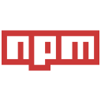
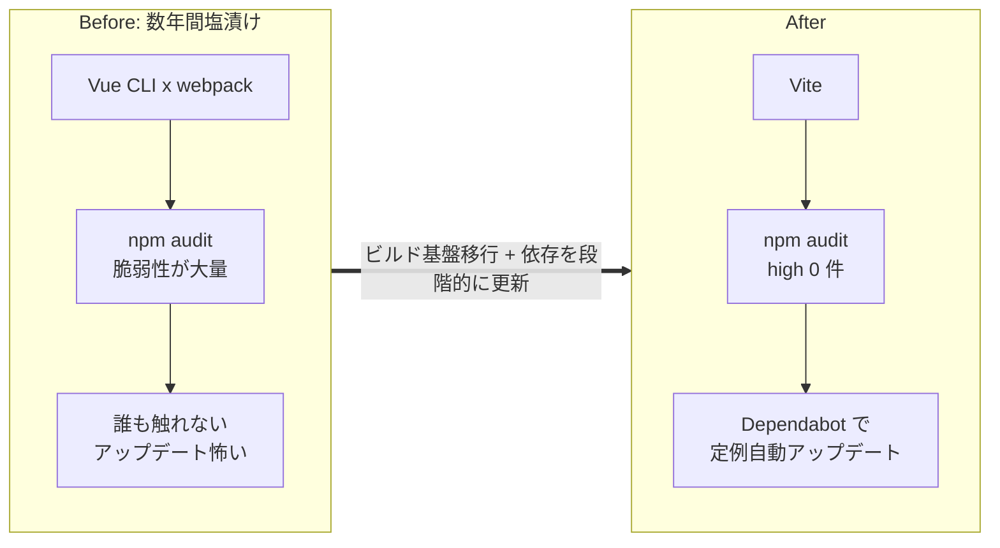
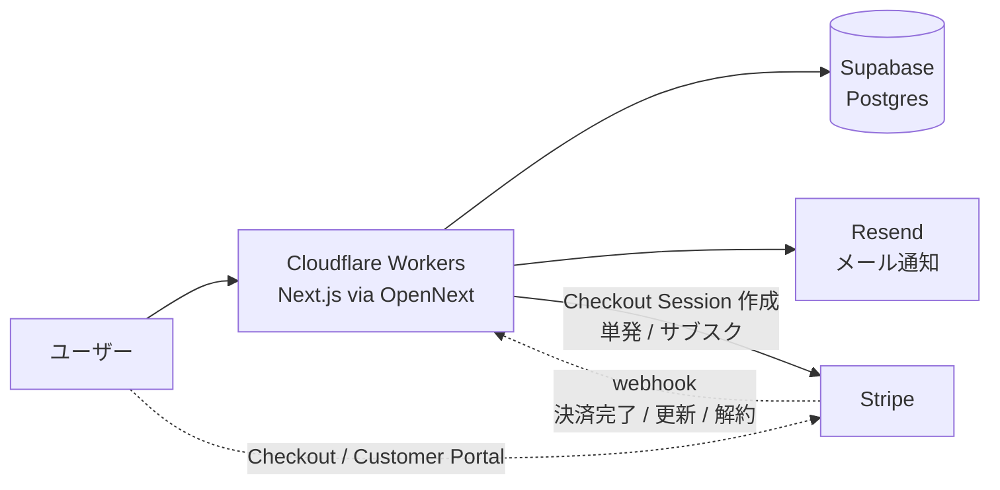
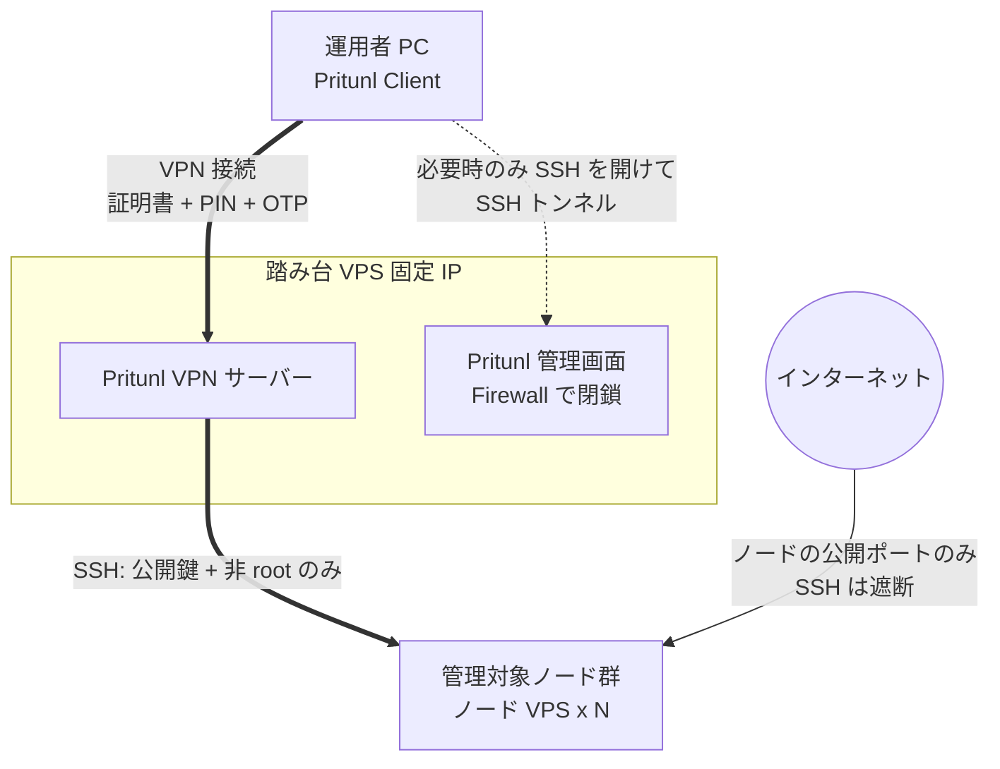
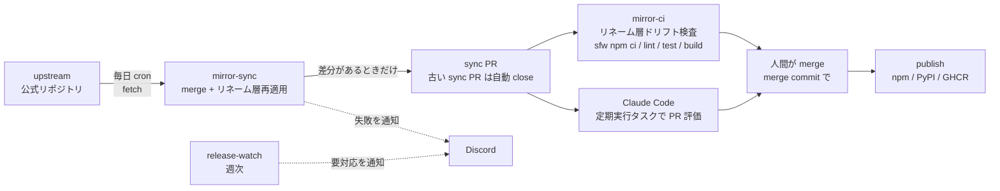

<!-- _class: lead -->
<!-- _paginate: false -->

# 最近のお仕事紹介

## 本業・副業・ボランティアで<br>「楽に・安く・ほどほどに」やってること

YasunoriMATSUOKA

---

## 自己紹介

- **YasunoriMATSUOKA**
- 新潟拠点・フルスタックエンジニア
- キャリアの軸はフロントエンド
- バックエンド・インフラは **コスパよくマネージドなサービスを使い倒してきた** スタンス
- 前回 (2026-05) は「技術スタック変遷」の振り返りでした → 今回は **今まさにやってること** の紹介

---

## 今日のアジェンダ

1. **本業** — 塩漬けフロントエンドを Vite × Dependabot で救出した話
2. **副業** — 畑多楽DAO で Claude Code と Stripe 決済を実装したら過去一楽だった話
3. **ボランティア ①** — ブロックチェーンノードの運用代行を引き継いだ話（踏み台 VPN 構成）
4. **ボランティア ②** — ブロックチェーン公式 OSS のミラー運用と、超ヘビー級 CI の相談

> ※ 個人の体験・主観です。デモや画面共有はリクエストベースで、支障ない範囲でお見せします 🙏

---

<!-- _class: lead -->

# Part 1
## 本業 — 塩漬けフロントエンドの救出

---

## ① 本業 (1/3) — スタック概観

<div class="logos">
  
  <span class="label">AWS CDK</span>
  
  
  
  
  
  
</div>

<div class="stack">
<strong>Infra:</strong> AWS / AWS CDK (TypeScript)<br>
<strong>Front:</strong> TypeScript / Vue.js<br>
<strong>Build:</strong> Vue CLI × webpack → <strong>Vite</strong><br>
<strong>依存更新:</strong> Dependabot
</div>

- 案件の詳細は言えないので **ふわっと** お話しします 🙏
- **数年間塩漬け** にされていたフロントエンドを引き取る
- `npm audit` を叩くと **脆弱性が画面を埋め尽くす** 状態からのスタート

---

## ① 本業 (2/3) — Before / After

<!-- _class: diagram-medium -->



<div class="note">ビルド基盤を Vite へ移行しつつ依存を頑張って上げ、<code>npm audit</code> の high をゼロに。最後に Dependabot で「上げ続けられる体制」を作った。</div>

---

## ① 本業 (3/3) — 移行の勘所と「上げ続ける」設定

<!-- _class: compact-code -->

```ts
// vite.config.ts — Vue CLI 時代の暗黙ルールを1つずつ明示していくイメージ
import { defineConfig } from 'vite'
import vue from '@vitejs/plugin-vue'          // Vue 2 系なら @vitejs/plugin-vue2
import { fileURLToPath, URL } from 'node:url'

export default defineConfig({
  plugins: [vue()],
  resolve: { alias: { '@': fileURLToPath(new URL('./src', import.meta.url)) } },
})
// よくハマる所: process.env.VUE_APP_* → import.meta.env.VITE_* / require() → import
//              public/index.html → ルート直下へ / .vue 拡張子の省略不可
```

```yaml
# .github/dependabot.yml — minor/patch はまとめて 1 PR、週次で淡々と回す
version: 2
updates:
  - package-ecosystem: npm
    directory: /
    schedule: { interval: weekly }
    groups: { minor-and-patch: { update-types: [minor, patch] } }
```

<div class="learn">塩漬けからの復帰は「一度きれいにする」より「<strong>上げ続けられる仕組みを置く</strong>」ほうが本体。CI で <code>npm audit --audit-level=high</code> をゲートにしておくと、二度と腐らない。</div>

---

<!-- _class: lead -->

# Part 2
## 副業 — 畑多楽DAO × Claude Code × Stripe

---

## ② 畑多楽DAO (1/4) — スタック概観

<div class="logos">
  
  
  <span class="label">OpenNext</span>
  
  
  
  
  
</div>

<div class="stack">
<strong>Front / Server:</strong> Next.js on Cloudflare Workers (OpenNext)<br>
<strong>DB:</strong> Supabase / <strong>Mail:</strong> Resend / <strong>Payment:</strong> Stripe（単発決済 + サブスク）<br>
<strong>開発:</strong> Claude Code でバイブコーディング 🤖
</div>

- 単発決済だけでなく **サブスクまで含めた決済機能** を Claude Code と実装
- 過去にも Stripe 決済は何度か実装してきたが… **過去一楽に実現できた**

---

## ② 畑多楽DAO (2/4) — 3 環境 & デモ

<div class="stack">
<strong>開発:</strong> <a href="https://dev.hataraku-dao.com/">https://dev.hataraku-dao.com/</a><br>
<strong>ステージング:</strong> <a href="https://test.hataraku-dao.com/">https://test.hataraku-dao.com/</a><br>
<strong>本番:</strong> <a href="https://hataraku-dao.com/">https://hataraku-dao.com/</a>
</div>

- 👉 **開発環境でデモ** します（決済フローを実際に通してみる）
- ソースコードは GitHub 非公開ですが、**お客様から技術共有 OK の確認をいただいています**
- リクエストあれば、支障ない範囲で **手元から GitHub の PR やソースコード** をお見せしながらお話しします

---

## ② 畑多楽DAO (3/4) — 構成

<!-- _class: diagram-large -->



<div class="note-float">
💡 <strong>一番楽だった形</strong><br>
・画面は <strong>Stripe のホスト型</strong> に寄せる<br>
　（Checkout / Customer Portal）<br>
・アプリは <strong>webhook → DB に冪等反映</strong> だけ
</div>

---

## ② 畑多楽DAO (4/4) — Workers で Stripe webhook を受ける

<!-- _class: compact-code -->

```ts
// イメージ: Workers には Node の同期 crypto が無いので Async 版 + SubtleCrypto を使う
import Stripe from 'stripe'
import { getCloudflareContext } from '@opennextjs/cloudflare'

export async function POST(req: Request) {
  const { env } = getCloudflareContext()
  const stripe = new Stripe(env.STRIPE_SECRET_KEY, { httpClient: Stripe.createFetchHttpClient() })
  const event = await stripe.webhooks.constructEventAsync(
    await req.text(), req.headers.get('stripe-signature')!, env.STRIPE_WEBHOOK_SECRET,
    undefined, Stripe.createSubtleCryptoProvider(),
  )
  switch (event.type) {
    case 'checkout.session.completed':     // 単発決済 / サブスク開始
    case 'customer.subscription.updated':  // プラン変更・更新
    case 'customer.subscription.deleted':  // 解約
    case 'invoice.payment_failed':         // 支払い失敗
      await applyToSupabase(event)         // event.id で冪等に
  }
  return new Response('ok')
}
```

<div class="learn">Stripe の公式ドキュメントが整っている × Claude Code が「Stripe の作法」をよく知っている、の掛け算で<strong>決済が過去一楽</strong>に。人間は「どのイベントで何を DB に反映するか」の設計とテストに集中できた。</div>

---

<!-- _class: lead -->

# Part 3
## ボランティア ① — ノード運用代行の継承

---

## ③ ノード保守代行 (1/4) — スタック概観

<div class="logos">
  
  
  
  <span class="label">Pritunl (VPN)</span>
  <span class="label">ufw / sshd</span>
</div>

<div class="stack">
<strong>サービス:</strong> Stir Hosyu Symbol — <a href="https://stir-hosyu.nemtus.com/">https://stir-hosyu.nemtus.com/</a><br>
<strong>Infra:</strong> VPS (Contabo) / Docker<br>
<strong>Access:</strong> Pritunl VPN（固定 IP の踏み台）/ SSH 公開鍵認証
</div>

- ブロックチェーン技術普及推進の **NPO 法人** でのボランティア活動
- ブロックチェーンノードの **運用保守代行サービスを他社から継承**
- お客様の **秘密鍵はお預かりしない** 形で、構築〜日々の保守を代行

---

## ③ ノード保守代行 (2/4) — 踏み台 VPN 構成

<!-- _class: diagram-medium -->



<div class="note">ノードは <strong>踏み台の固定 IP からの SSH だけ</strong> を許可。踏み台自身も普段は SSH を閉じている。</div>

---

## ③ ノード保守代行 (3/4) — 設定のイメージ

<!-- _class: compact-code -->

```bash
# 管理対象サーバー側 Firewall: SSH は踏み台の固定 IP からのみ
ufw default deny incoming
ufw allow from 203.0.113.10 to any port 22 proto tcp   # 踏み台 (例示用 IP)
ufw allow 7900/tcp                                    # ノードの公開ポート (例)
ufw enable
```

```ini
# /etc/ssh/sshd_config.d/hardening.conf
PermitRootLogin no              # root ログイン禁止（作業用ユーザー + sudo）
PasswordAuthentication no       # パスワード認証禁止
KbdInteractiveAuthentication no
PubkeyAuthentication yes        # 公開鍵のみ
AllowUsers operator             # ログインできるユーザーを限定
```

<div class="note">Pritunl 管理画面 (443) も Firewall で閉じ、必要なときだけ <code>ssh -L 8443:localhost:443 bastion</code> のような SSH トンネルでアクセス → 終わったら SSH ごと閉じる。</div>

---

## ③ ノード保守代行 (4/4) — 脆弱性との付き合い方

- 脆弱性ニュースに **常にアンテナを張る**（OpenSSH / カーネル / Docker / VPN / ノードソフト…）
- やばめな脆弱性が出たら **即パッチ**
- パッチ公開が遅い場合は **緩和策を先に適用**（設定変更・ポート閉鎖・機能無効化など）
- お客様向けには **サイトのお知らせで対応状況を公開**（バージョンアップ対応、VPS 事業者のインシデント確認結果など）

<div class="pain">
セキュリティに気を付けつつ運用するのは、正直<strong>なかなか大変</strong>…<br>
ボランティアでもお客様のノードを預かる以上、手は抜けない。
</div>

---

## ③ 裏話 — Contabo のセキュリティインシデント 😇

- 利用中の VPS 事業者 **Contabo でセキュリティインシデント** が発生
- 「うちのサーバーは大丈夫？」を **全台について調査** する羽目に
  - 不審なログイン・鍵の追加・プロセス / cron / コンテナの改ざんが無いか
  - 事業者側の発表を追いかけつつ、影響範囲を自分たちで切り分け
- 確認結果は **サイトのお知らせでお客様へ報告**

<div class="pain">
自分たちの設定をいくら固めても、<strong>インフラ事業者側の事故</strong>は防げない。<br>
「侵害されていないこと」を示す調査は、侵害対応と同じくらい手間がかかって大変だった…
</div>

> 👉 リクエストあれば、Contabo の管理画面や、**NEMTUS 自己管理のサーバー**（お客様のサーバーではない）に SSH で入って雰囲気をお見せします

---

<!-- _class: lead -->

# Part 4
## ボランティア ② — 公式 OSS のミラー運用

---

## ④ OSS ミラー (1/5) — github.com/nemtus の全体像

<div class="logos">
  
  
  
  
  
  
  
</div>

| 分類 | 主なリポジトリ |
|---|---|
| **公式 OSS ミラー** | `symbol` / `symbol-product` / `symbol-bootstrap` |
| **ネットワーク / ノード運用** | `symbol-networks` / `node-management` |
| **SDK / クライアント** | `symbol-rest-api-client`（OpenAPI Generator） |
| **Web アプリ / LP** | `apps`（HACK+ / 物販 / LP 群。Cloudflare へ移行中） |
| **書籍・ハンズオン** | `tbf*-qls*` / `symbol-sdk-hands-on` / `tech-blog` |

---

## ④ OSS ミラー (2/5) — 何をしているか

<div class="stack">
<strong>ミラー元:</strong> とあるブロックチェーンの公式 OSS リソース一式（SDK / ノード / セットアップツール）<br>
<strong>再配布先:</strong> npm (<code>@nemtus/*</code>) / PyPI (<code>nemtus-*</code>) / GHCR (<code>ghcr.io/nemtus/*</code>)
</div>

- upstream のソースは **原則そのまま**、パッケージ名などの **リネーム層だけ** を重ねる
- upstream が止まっても / 消えても、コミュニティが使い続けられる状態を担保したい
- 方針は **「upstream にできるだけ楽に追従する」**
  - 差分を最小に保つ → 追従コストを最小に
  - 毎日自動で取り込み PR を作る → 人間はレビューと merge だけ

---

## ④ OSS ミラー (3/5) — 追従の仕組み

<!-- _class: diagram-large -->



<div class="note">upstream のリリースタグとミラー側イメージ・設定の pin がずれていないかも週次で監視し、Discord に通知。</div>

---

## ④ OSS ミラー (4/5) — mirror-sync の核

<!-- _class: compact-code -->

```yaml
# .github/workflows/mirror-sync.yml（抜粋・簡略化）
on:
  schedule: [{ cron: '17 3 * * *' }]     # 毎日
  workflow_dispatch:
jobs:
  sync:
    permissions: { contents: write, pull-requests: write }
    steps:
      - run: |
          git remote add upstream https://github.com/<upstream>.git
          git fetch --no-tags upstream dev
          # 既に取り込み済みなら即終了（古い sync PR の掃除だけ）
          if git merge-base --is-ancestor upstream/dev HEAD; then exit 0; fi
          git checkout -B "sync/upstream-$(git rev-parse --short upstream/dev)"
          git merge -X theirs --no-edit --no-commit upstream/dev || true   # 衝突は upstream 優先
          bash .github/scripts/apply-nemtus-patch.sh                       # リネーム層を再適用
          # → ツリーが dev と同一なら PR を作らない（内容ベース判定）
```

<div class="learn">sync PR は <strong>必ず merge commit</strong> で。Squash すると upstream が祖先から外れ、次回から全履歴が巨大 diff として再生される。</div>

---

## ④ OSS ミラー (5/5) — PR 評価を Claude Code に 🤖

- 定期的に自動作成される sync PR を、**Claude Code の定期自動実行タスク** で評価
  - upstream 側の変更内容の要約（何が変わった？ リリースを伴う？）
  - リネーム層 / 自前ワークフローへの影響、要注意な依存追加がないか
  - CI 結果と合わせて **「merge して良さそうか」の一次判断** をコメント
- **最終判断と merge は人間**。ただし「毎回ゼロから diff を読む」負担は激減

<div class="pain">
とはいえ AI の評価をどこまで信じるか、の線引きはまだ手探り。<br>
サプライチェーン対策（Socket Firewall・SHA pin・CI ゲート）と組み合わせて多層防御にしている。
</div>

---

## みんなで相談したい — 超ヘビー級 CI/CD 🙏

<div class="stack">
ノード本体（C++）のコンテナイメージビルドが <strong>1 回あたり約 1 時間</strong>。<br>
upstream のビルド手順（依存ライブラリのビルド含む）をそのまま追従しているため重い。
</div>

- 今の前提
  - GitHub-hosted runner（標準）+ `docker buildx`、サードパーティ action は極力使わない方針
  - upstream の Dockerfile 相当を **生成** して追従（依存の再定義はしない）
- アイデア / 相談したいこと
  - buildx のレイヤーキャッシュ（`type=gha` / registry cache）はどこまで効く？
  - 依存ビルドのステージだけ **別イメージに切り出して** たまにしか回さない？
  - ccache / より大きな runner / self-hosted runner のコスパは？
  - **「楽に・安く・ほどほどに」** 速くするなら、どこから手を付けますか？

---

<!-- _class: lead -->

# まとめ

---

## まとめ — 最近のお仕事を通して思うこと

- **本業**: 塩漬けは「一度直す」より **上げ続けられる仕組み** を置くのが本体
- **副業**: Claude Code × Stripe で決済が **過去一楽**。人間は設計とテストに集中
- **ボランティア ①**: 踏み台 VPN + 多要素 + SSH 制限で守りつつ、**脆弱性対応は終わりがない**
- **ボランティア ②**: upstream 追従は **差分最小 + 自動 PR + AI 一次評価** で楽に
- どれも結局 **「楽に・安く・ほどほどに」** を目指している 🚀

---

<!-- _class: lead -->

# ありがとうございました 🙏

デモ・画面共有のリクエスト、<br>CI 高速化のアイデア、大歓迎です

YasunoriMATSUOKA
